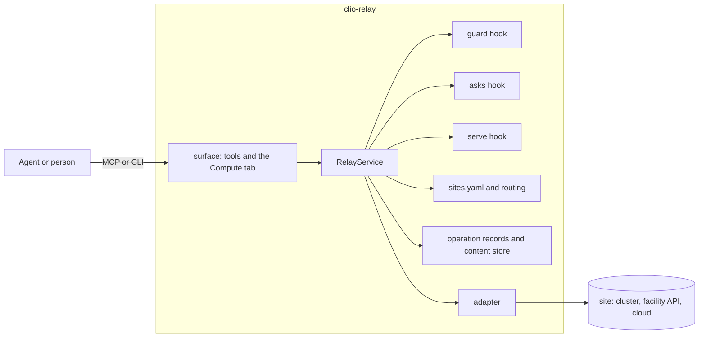

# Architecture

Relay is an MCP server with twelve tools (the five verbs, `install`, the read tools
`exec_read` and `files_read`, `packages`, `cancel`, `site_clean` and
`shutdown`), a command line, and a
set of adapters
that each know one way into a site. This page follows a call from the agent to
the site and back.

## A call, top to bottom

1. **Surface.** `surface/server.py` serves the verbs `describe`, `run`,
   `exec`, `files` and `serve` over stdio or Streamable HTTP, with `packages`
   (list, stage and remove the packages `run` takes, `surface/staging.py`) and
   `shutdown` beside them. Two changes have tools of their own, so a host's
   question names what they do (`surface/site_tools.py`): `cancel` cancels a
   job or stops a service, and `site_clean` removes relay's deployment from a
   site after the person's yes, keeping the Spack store and JARVIS's recorded
   install answers as `clio-relay site clean` does (`forget_decisions` drops
   the answers). The tools that only read, `describe`, `exec_read`
   (the read-only command list of [guarded sites](guarded-sites.md#read-only-exec))
   and `files_read` (list, stat, read and has), live in `surface/read_tools.py`;
   the result rendering and the annotations are in `surface/results.py`.
   `describe` also lists the staged packages (`packages=true`) and gives a
   service's endpoint and readiness (`job=<service>`). `run` and `serve`
   are MCP tasks when the client supports them (see [MCP tasks](mcp-tasks.md)).
   `install` (`surface/install_tool.py`, `surface/install_op.py`) is a run's
   install task on its own, and a task too: it asks JARVIS's light
   `ppl install +check`, which runs no Spack on the login host and answers
   from the record (`install-check.json`) of the last check a job made. With no
   matching record (`install_unchecked`) relay asks nothing and submits a
   check job (the site script's `recheck` mode, `ppl install +check +submit`).
   When JARVIS reports only questions, relay asks them, then runs that check
   job with the answers, so nothing is asked or built when everything is
   installed. It
   takes the run's install path when software is missing (the same asks, then
   `ppl install +submit` as a job on the compute nodes), installs relay's
   jarvis-cd first when the site lacks it, and launches nothing. A run's
   submit asks the same light check before `ppl submit`, so the person is
   still asked before any job of the run is submitted. Operations
   that find a site without jarvis-cd at once share one site-scoped ask
   (`surface/install_share.py`), and the bootstrap's lock in the site home
   makes a second install wait for the first and reuse it. A JARVIS question
   scoped to the site (which MPI) is shared the same way: operations that get
   the same `issue_id` with the same candidates hold one ask, and its answer
   reaches each install.
   The tools only translate arguments; all behaviour is in the service. The
   server's `instructions`, which a client reads when it connects, name the
   configured sites and the staged packages (`surface/instructions.py`), so an
   agent knows what relay can run before it calls a tool. The tool annotations
   say the three read tools only read and never destroy (`readOnlyHint` true,
   `destructiveHint` false) and the rest change things, all in a closed world:
   relay touches only the sites you registered, and the guard below asks for
   what their policy names. So a client that accepts bounded changes without a
   question can run relay calls unattended, and relay's own asks still reach you.
2. **Service.** `surface/service.py` holds `RelayService`, which the MCP
   server, the CLI and the tests all drive. It loads the site from
   `sites.yaml`, picks the adapter for the verb, and keeps a durable record of
   every operation.
3. **Routing.** A site names one adapter and may list alternatives. For each
   verb, `sites/routing.py` picks the first adapter that implements it; `clio-relay
   site show <id>` prints the choice.
4. **Guard.** Before anything runs, the guard hook decides: an open site runs
   what the agent asks, a guarded one runs only reviewed packages and
   read-only commands, and asks before it spends an allocation. See
   [guarded sites](guarded-sites.md).
5. **Asks.** A question for the person (a sign-in, an approval, a one-time
   code) is a durable ask. A client with tasks or elicitation shows it; any
   other path (`clio-relay asks`, the Compute tab, a single-use web page) can
   answer it.
6. **Adapter.** The adapter carries the call to the site and returns a typed
   result or a typed refusal. Its contract is `adapters/base.py`; see
   [adding an adapter](adding-an-adapter.md).

## State

Relay keeps its state in two directories, both set by environment variables
and both plain files:

| Directory | Holds |
| --- | --- |
| Config (`CLIO_RELAY_CONFIG_DIR`) | `sites.yaml`, `guard.yaml`, your own skills |
| State (`CLIO_RELAY_STATE_DIR`) | Operation records, asks, the content store, the staged package catalog, each adapter's own files, reviewed packages, the rendezvous settings |

An operation record holds the spec, its digest, the site, the adapter's job
handle and the states seen. Any relay process can observe, answer or cancel
an operation by its id, so a restarted relay, the CLI and the MCP server all
see the same jobs. Relay submits each operation once: the record is written
before the adapter is called, and `find` reconciles a job whose handle was
never recorded.

The content store holds bytes by SHA-256. `files(op="stage")` puts them there,
and a job input names them by digest, so the same input is never uploaded
twice.

## Hooks

Three parts of relay are hooks, loaded through the `clio_relay.hooks` entry
points: `guard`, `asks` and `serve`. Relay ships a stub of each, so the core
runs and tests alone; the real ones are in `guard/`, `asks/` and `serve/`.

## Services and ports

`serve` starts a long-running process on a site and forwards its ports to
`127.0.0.1` on your machine. A site reached over ssh uses an `ssh -L` forward.
Any other site uses a rendezvous host, where frp clients on both ends meet;
see [rendezvous host](rendezvous-host.md).

## The worker

The `worker` adapter runs a small relay process on the cluster, which runs
jobs there and answers through the rendezvous host after one ssh sign-in. Its
site side uses the same local adapter and files rules as relay itself. See
[worker](adapters/worker.md) and [operations](operations.md).

## Package layout

[CONTRIBUTING](../CONTRIBUTING.md#layout) lists each package and what it holds.
